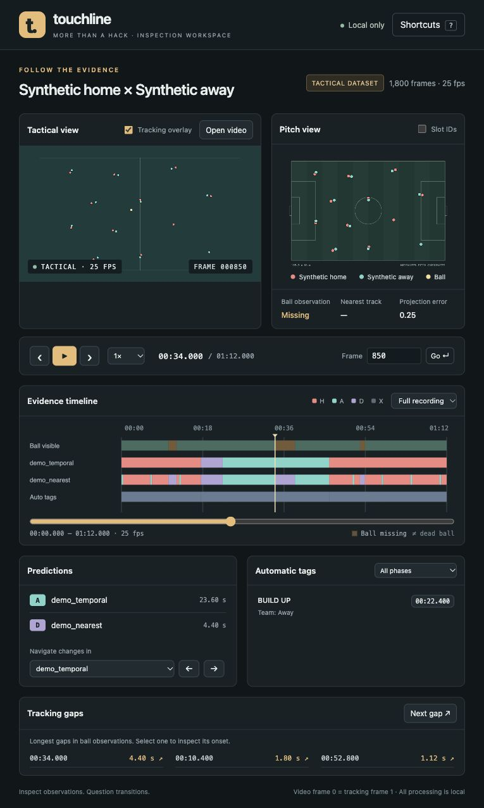

# Touchline — local possession inspector

A read-only inspection workspace for More Than A Hack 2027. Step through tactical video, see player and ball positions on the pitch, project tracking onto video, compare prediction intervals, inspect automatic tags, and jump to missing-ball stretches.



Runs on **Python 3.10+**, using only the standard library. No installation, Node build, cloud account, or external web services are needed. Node 18+ is only needed to run the JavaScript unit tests.

## Start with the synthetic demo

```sh
python3 -m inspector --demo
```

Open **http://127.0.0.1:8765**. The 72-second demo generates 22 tracks, ball gaps, automatic tags, and two example predictions. They are synthetic, not challenge data or a trained model. Without a configured `data/` directory, launching with no arguments also opens the demo. No sample video is bundled; **Open video** lets you select a local file without uploading it.

## Inspect published predictions before downloading the match

The organiser publishes four complete baseline CSVs in [evaluation/results](https://github.com/metrica-sports/more-than-a-hack-2027/tree/main/evaluation/results). Download those files into `local/published-baselines/`, then run:

```sh
python3 -m inspector --predictions-only \
  --prediction local/published-baselines/baseline_raw.csv \
  --prediction local/published-baselines/baseline_smooth25.csv \
  --prediction local/published-baselines/baseline_smooth50.csv \
  --prediction local/published-baselines/baseline_smooth125.csv
```

This mode loads the supplied CSV labels across all 199,319 frames without generating any observations. The interface explicitly marks tracking as **Not loaded**; ball-visibility percentages and tracking gaps are unavailable. These are model outputs, not possession ground truth. For these published BAR–ATH outputs, H means Barcelona and A means Athletic Club. You can navigate transitions, compare disagreement, and use the half jumps. `--video` can add a matching local video, but tracking and homography still require the full dataset mode below.

Do not overlay published match predictions on the synthetic demo. Prediction-only mode is separate from `--demo` and `--data-dir`. CSV files under `local/` remain outside source control.

## Inspect the match

Keep the downloaded bundle outside source control, for example:

```text
data/
  tactical/
    BAR-ATH_tactical.mp4
    BAR-ATH_tactical_atd.xml
    BAR-ATH_tactical_atd.txt
    BAR-ATH_tactical_homography.csv
    BAR-ATH_tactical_smart_tagging.xml
```

```sh
python3 -m inspector --data-dir ./data \
  --prediction ./local/baseline_raw.csv \
  --prediction ./local/candidate.csv
```

`--data-dir` also accepts the `tactical/` directory directly. `MTAH_DATA_DIR` is supported. Tracking metadata and raw tracking are required; video, homography, tags, and predictions are optional. Add up to eight `--prediction` arguments. Restart the server after replacing a prediction or dataset file. The viewer does not watch or modify source files.

Optional arguments:

- `--video /absolute/path/to/video.mp4`: override the video location.
- `--port 8766`: use another local port.
- `--frames N --fps F`: explicit overrides for other datasets or synthetic fixtures. Challenge defaults are 199,319 frames at 25 fps. Do not use these overrides to hide a mismatch in the challenge bundle.
- `http://127.0.0.1:8765/?frame=11185`: open at a particular zero-based tactical frame.

Stop the server with **Ctrl+C**. It listens on **127.0.0.1 only**. It exposes only the viewer assets, configured dataset, and configured video; it does not serve arbitrary local files. Cross-origin access is rejected. The app uses no remote scripts, fonts, analytics, or network APIs.

## Inspection controls

- **Space** plays/pauses. **Left/Right** steps one frame; **Shift + Left/Right** steps one second. Shortcuts do not interrupt text fields or selects. Space activates a focused button normally; click the page background to use it for playback.
- Enter a frame number and press **Go** or **Enter**. Timeline clicks and the scrubber seek to the same frame.
- Change the timeline window between the whole recording and 60, 20, or 5 seconds.
- Choose a prediction source, then use **[ / ]** or arrow buttons to jump between its label changes.
- Select a gap or **Next gap** to inspect missing observations. Gaps are not classified as stoppages.
- Filter active automatic tags by phase. When none are active, jump to the next matching tag.
- Toggle projected tracking and temporary track-slot labels. The nearest-player readout is geometric evidence, not an inferred possessor.
- **?** opens the keyboard guide.

## Alignment and limitations

All views use the tactical timeline. Raw tracking IDs `1…N` become video frames `0…N−1`. Tag seconds are multiplied by FPS and rounded like the official starter; their end frame is exclusive. Homographies map normalized pitch coordinates to image pixels. Missing player/ball observations become `null`; invalid homographies disable projection for that frame. No long-gap interpolation or invented positions are shown.

Prediction CSVs must have exactly `frame,label`, ordered contiguous frames from zero, the configured row count, and labels `H/A/D/X`. Header and label case/whitespace are normalized. Invalid files fail at startup with a useful error. This viewer is not the official submission validator or scorer; run the organiser's validator on the final CSV.

Video playback uses presented video-frame timestamps (`requestVideoFrameCallback`) when supported, with a time-update fallback. Paused seeking targets a time inside the requested frame. Use the original constant-frame-rate tactical video; a different edit, variable-frame-rate transcode, or incorrect FPS cannot be repaired by a time offset here. A duration mismatch produces a warning. Tracking remains selectable and can play beyond a shorter video; video and projection are hidden outside its coverage. Playback stops at the final tracking frame even if the video is longer. Projection requires the original 1920 × 1080 video; other dimensions show a warning and disable the overlay. Browser codec support varies; H.264 MP4 is recommended. Broadcast synchronization is not implemented.

The raw tracking and homography files are indexed once at startup. Requests read at most 250 frames, and the browser keeps at most ten 125-frame windows. At most two tracking requests stay active, and obsolete seek requests are cancelled. Predictions and tags are loaded as compact intervals; highly fragmented predictions can still make the initial manifest large. Timeline overview drawing is bounded by pixel width: bronze bins mark mixed states at this zoom, while the detail cards retain exact frame labels. Zoom in to resolve individual changes. Keep source files unchanged while the server runs.

This tool has **no annotation, label-editing, or export workflow**. Do not use inspection to make hand labels or frame-specific corrections on the competition match. Restricted assets stay local and must not be sent to hosted LLMs or committed. See the [challenge rules](https://github.com/metrica-sports/more-than-a-hack-2027/blob/main/RULES.md) and [FAQ](https://github.com/metrica-sports/more-than-a-hack-2027/blob/main/FAQ.md).

## Tests

```sh
python3 -m unittest discover -s tests -v
node --test tests/test_*.mjs
```

Tests use generated fixtures, not match extracts. They cover one-based tracking alignment, missingness, optional assets, tag intervals, homography validity, CSV rejection, video byte-range seeking, API limits, local-only access, timeline boundaries, projection, and distance calculations. Browser QA should also exercise playback, frame steps, timeline seeking, prediction navigation, video loading, and a narrow viewport.

To exercise the actual file adapters in the browser with generated data:

```sh
python3 tests/make_browser_fixture.py /tmp/touchline-fixture
python3 -m inspector --data-dir /tmp/touchline-fixture --frames 1800 \
  --prediction /tmp/touchline-fixture/demo_temporal.csv \
  --prediction /tmp/touchline-fixture/demo_nearest.csv
```

The fixture writer requires a new or empty directory. Add `--video` with a 72-second, 25-fps local test video to exercise server-streamed playback.

The real match bundle was not available during initial implementation. Parser compatibility is based on the official starter formats and synthetic integration fixtures; full-match performance and actual-video alignment still need verification with the licensed assets.

See [the verification record](docs/TESTING.md) for the browser checks and their scope.
